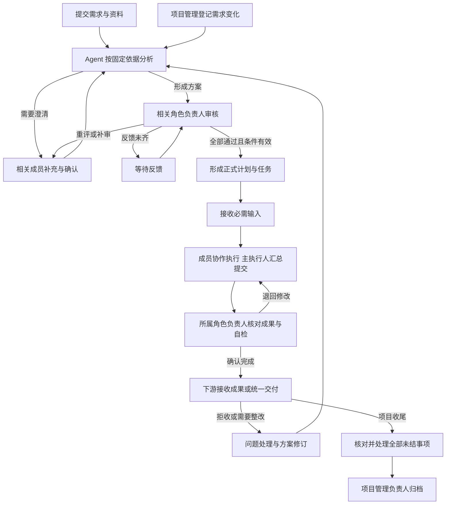

# 协作服务需求文档

## 项目初衷

将分散的资料、任务、成果和决定通过统一的版本管理仓库连接起来，为 Agent 提供可追溯、按需获取的上下文，通过各专业角色审批，实现半自动化持续推进项目。人工负责审核与专业判断，系统负责组织信息、跟踪流程和保存依据。

工作台面向多人团队，让成员清楚知道：资料在哪里、下一步做什么、等待谁处理、应该使用哪个版本，以及决定的依据是什么。

- **统一版本管理**：按项目关联资料、任务、成果和决定，保留各自版本及相互关系，不限定物理仓库或存储方式。
- **半自动推进**：系统分析、生成待办并衔接流程；成员制作专业成果，负责人审核并作出决定。
- **角色审批**：由每个相关角色的负责人代表该角色审核，不是全体成员逐人投票。本文统一称为“角色审核”。

## 适用对象与分工

| 对象 | 主要责任 |
| --- | --- |
| 管理员 | 管理团队成员、任免项目管理负责人、维护系统配置和运行保障，不代替专业审核。 |
| 项目管理负责人 | 任免其他角色负责人、分配项目职责、跟踪进度、办理交接与归档，并组织需求和统一交付。 |
| 角色负责人 | 代表职责角色审核方案、确认任务完成、接收成果及确认问题处理结果。 |
| 执行成员 | 主执行人汇总成果与自检，协作者贡献进展和材料；共同按分派完成专业工作。 |
| Agent 与系统 | 按依据提出建议，检查处理条件，生成待办和通知，保存版本与历史。 |

团队内全部项目业务内容可读，修改与决定按职责授权；凭据等管理信息不属于公开业务内容。项目使用固定九类专业角色，一个成员可承担多个角色，每个启用角色只设一名有效负责人和若干参与者；负责人暂缺时，相关决定等待接任。职责详见[项目与角色管理](01-项目与角色管理.md)。

## 关键概念

| 概念 | 含义 |
| --- | --- |
| 方案与正式计划 | 方案是待审核的工作建议；全部相关角色通过且条件有效后，才形成正式计划。 |
| 任务与通知 | 任务需要执行或反馈；通知用于告知，可指向任务，但阅读通知不代表处理任务。 |
| 固定版本 | 某次保存或发布时的确定内容；后续更新不能替换历史引用。 |
| 输入与成果 | 输入是任务所用资料或上游成果；成果是该任务按要求提交的工作结果。 |
| 任务关系 | 连接任务、资料、成果及决定，区分“计划需要什么”和“实际采用了什么”。 |
| 完成与接收 | 完成表示本任务符合约定要求；接收表示下游确认某个成果版本可供其使用。 |
| 任命与接任 | 任命指定候任人；候任人核对在办责任并确认接任后，才取得负责人职责。 |
| 问题与风险 | 问题记录需澄清或整改的事项；严重风险记录可能影响已有成果或后续工作的情况。 |

保存进展、确认完成、接收成果、解决问题、处理风险和通知已读各自独立，不能互相代替。

## 整体业务流程

- 没有必需输入的任务，在其他开始条件满足后即可执行；可提前交接的阶段成果拆成独立任务。
- 有拒绝时先收齐本轮反馈再重评；方案基准或审核范围变化时重新核对并审核，不能沿用过期同意；生效前的补审异议须由提出异议的角色确认处理充分。无需调整计划时记录结论，不强行生成任务。
- 技术故障与资料不足分别处理；结果不明时先核对，不盲目重复执行。分析和重评均受次数及用量限制。
- 需求变化不自动暂停已生效任务。项目成功交付或经审核停止后，均须处理完在办事项、问题及风险才能归档；取消不等于完成。
- 归档后业务只读，仍可阅读、记录个人已读及办理管理性交接。新问题先通过团队沟通，由项目管理负责人主动恢复后登记，不另设恢复申请。
- 紧急停权可先于交接；新任确认后才承接职责。全部管理员不可用时，须管理员权限的相应操作停用，其他已有授权的工作可继续；必须由 Agent 分析的事项在其不可用时等待，不通过人工代分析或强制收尾绕过。

## 模块导航

| 模块 | 要解决的问题 | 编号 |
| --- | --- | --- |
| [01 项目与角色管理](01-项目与角色管理.md) | 谁参与项目、如何分工与交接 | PRJ |
| [02 仓库整理与资料管理](02-仓库整理与资料管理.md) | 资料如何归集、查找和整理 | MAT |
| [03 Agent 分析与上下文](03-Agent分析与上下文.md) | 如何按需获取可靠信息并分析 | CTX |
| [04 项目推进与方案审核](04-项目推进与方案审核.md) | 建议如何经过审核成为计划 | PLAN |
| [05 任务执行与成果交接](05-任务执行与成果交接.md) | 如何执行、完成并交接成果 | TASK |
| [06 需求变化与任务整改](06-需求变化与任务整改.md) | 需求和成果变化后如何继续推进 | CHG |
| [07 问题澄清与风险处理](07-问题澄清与风险处理.md) | 如何处理拒收、信息缺口和风险 | ISSUE |
| [08 通知与待办协同](08-通知与待办协同.md) | 如何找到需要处理或知晓的事项 | NOTICE |
| [09 历史追溯](09-历史追溯.md) | 如何核对版本、来源和决定 | TRACE |
| [10 运行管理与数据保障](10-运行管理与数据保障.md) | 如何配置、监控、恢复和保护数据 | OPS |

首次使用按 **01 → 02 → 03 → 04 → 05** 阅读；需求变化或成果拒收时阅读 **06、07**；通知、历史和运行保障贯穿全程。

## 文档使用

本文定义产品应具备的能力及可观察的验收条件，不表示功能已经实现或验收通过。各模块按“目的、核心需求、关键规则、验收要点”组织，需求编号用于沟通和验收追踪。

不规定操作系统、部署方式、技术栈或固定页面布局。界面和实现可以调整，但不能改变职责、审核条件、历史事实与数据保护要求。
